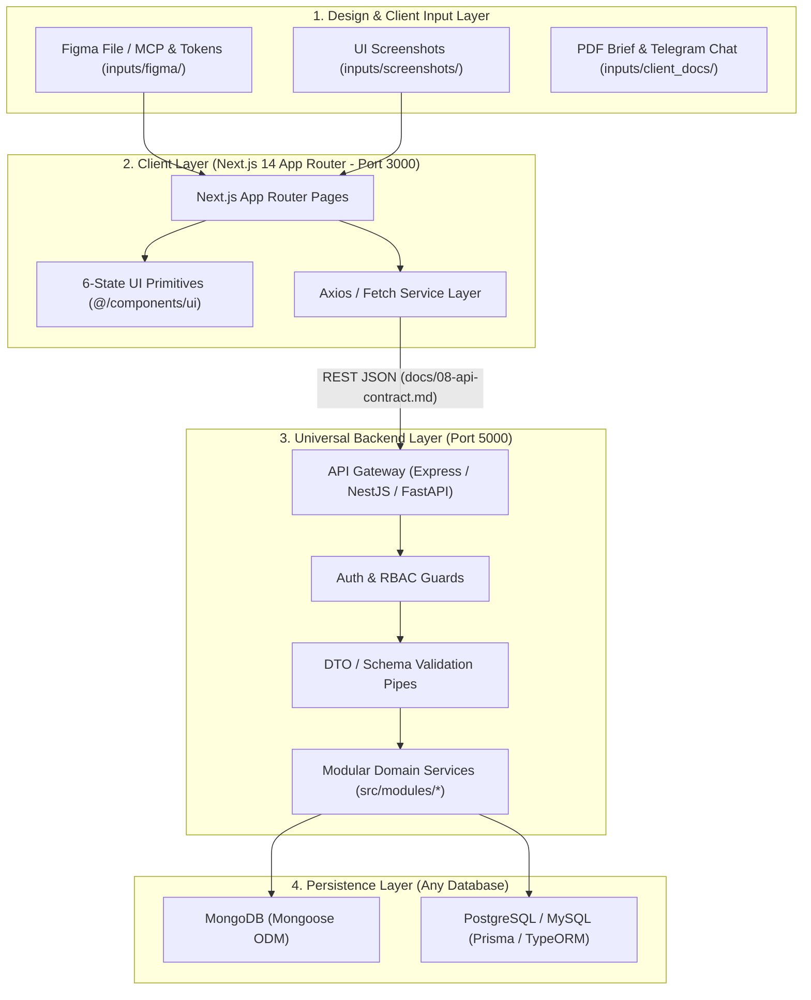
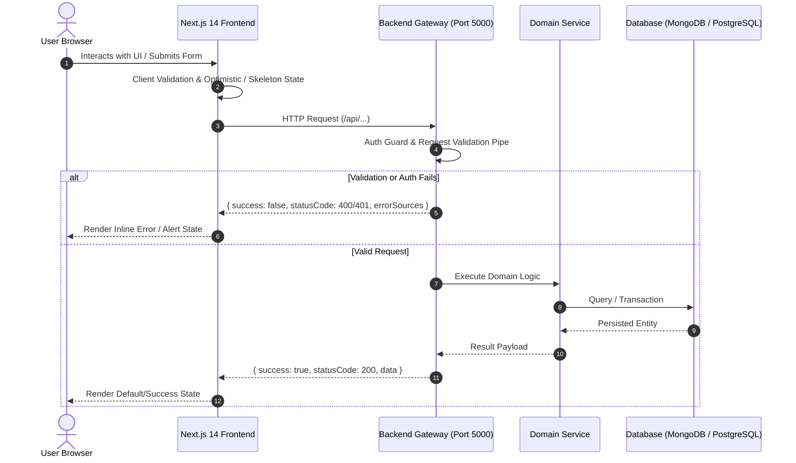

# 02 — System Architecture & Visual Flowcharts

> **Synchronized with**: `PRD_AND_PLAN.md` & `project.config.md`

---

## 1. Universal Full-Stack System Architecture

---

## 2. End-to-End API Request-Response Sequence

