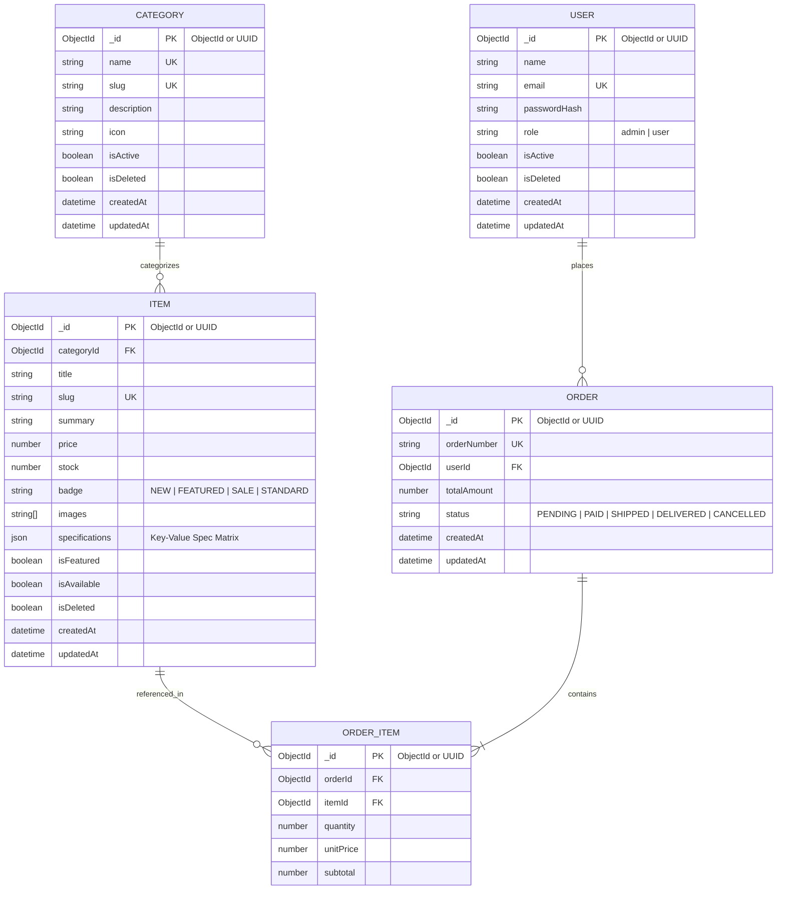

# 07 — Database Design & Multi-ORM Schema Blueprint (`docs/07-database-design.md`)

> **Synchronized with**: `PRD_AND_PLAN.md` & `planning/BACKEND_PLAN.md`  
> **Active Backend Stack**: `EXPRESS_MONGOOSE` *(Universal support for `EXPRESS_PRISMA_POSTGRES`, `NESTJS_PRISMA_POSTGRES`, `FASTAPI_PYTHON`, `CUSTOM_ANY`)*  
> **Mandatory Rule**: Before writing any database models or migrations, generate the Visual Mermaid ERD below based on the SRS, Figma screens (`docs/03-figma-analysis.md`), and frontend components.

---

## 1. Visual Entity Relationship Diagram (Mermaid ERD)



---

## 2. Option A: Mongoose ODM Blueprint (`EXPRESS_MONGOOSE`)

```typescript
import { Schema, model, Types } from 'mongoose';

export interface ICategory {
  name: string;
  slug: string;
  description?: string;
  icon?: string;
  isActive: boolean;
  isDeleted: boolean;
}

export interface IItem {
  title: string;
  slug: string;
  categoryId: Types.ObjectId;
  summary: string;
  price: number;
  stock: number;
  badge: 'NEW' | 'FEATURED' | 'SALE' | 'STANDARD';
  images: string[];
  specifications: Record<string, string>;
  isFeatured: boolean;
  isAvailable: boolean;
  isDeleted: boolean;
}

const itemSchema = new Schema<IItem>(
  {
    title: { type: String, required: true, trim: true },
    slug: { type: String, required: true, unique: true, index: true },
    categoryId: { type: Schema.Types.ObjectId, ref: 'Category', required: true, index: true },
    summary: { type: String, required: true, trim: true },
    price: { type: Number, required: true, min: 0, index: true },
    stock: { type: Number, default: 0, min: 0 },
    badge: {
      type: String,
      enum: ['NEW', 'FEATURED', 'SALE', 'STANDARD'],
      default: 'STANDARD',
    },
    images: [{ type: String }],
    specifications: { type: Map, of: String, default: {} },
    isFeatured: { type: Boolean, default: false, index: true },
    isAvailable: { type: Boolean, default: true, index: true },
    isDeleted: { type: Boolean, default: false, index: true },
  },
  { timestamps: true }
);

export const Item = model<IItem>('Item', itemSchema);
```

---

## 3. Option B: Prisma SQL Blueprint (`EXPRESS_PRISMA_POSTGRES` / `NESTJS_PRISMA_POSTGRES`)

```prisma
datasource db {
  provider = "postgresql"
  url      = env("DATABASE_URL")
}

generator client {
  provider = "prisma-client-js"
}

model Category {
  id          String   @id @default(uuid())
  name        String   @unique
  slug        String   @unique
  description String?
  icon        String   @default("Layers")
  isActive    Boolean  @default(true) @map("is_active")
  isDeleted   Boolean  @default(false) @map("is_deleted")
  items       Item[]
  createdAt   DateTime @default(now()) @map("created_at")
  updatedAt   DateTime @updatedAt @map("updated_at")

  @@index([slug])
  @@map("categories")
}

model Item {
  id             String   @id @default(uuid())
  categoryId     String   @map("category_id")
  category       Category @relation(fields: [categoryId], references: [id])
  title          String
  slug           String   @unique
  summary        String
  price          Decimal  @db.Decimal(12, 2)
  stock          Int      @default(0)
  badge          String   @default("STANDARD")
  images         String[]
  specifications Json     @default("{}")
  isFeatured     Boolean  @default(false) @map("is_featured")
  isAvailable    Boolean  @default(true) @map("is_available")
  isDeleted      Boolean  @default(false) @map("is_deleted")
  createdAt      DateTime @default(now()) @map("created_at")
  updatedAt      DateTime @updatedAt @map("updated_at")

  @@index([slug, categoryId])
  @@map("items")
}
```
