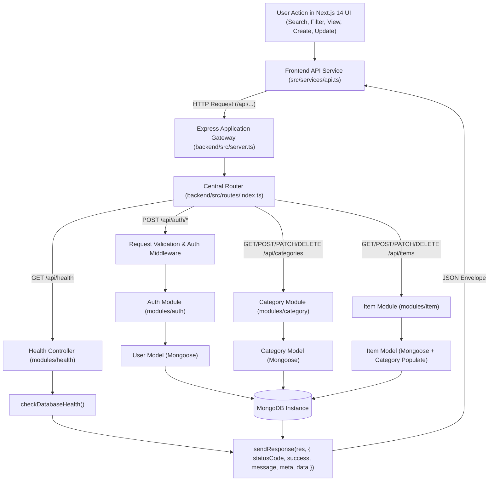
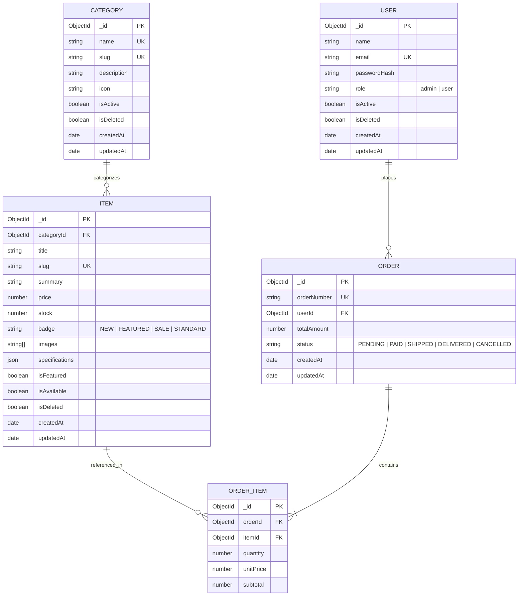

# 🛡️ Backend Pre-Execution Gate Plan (`planning/BACKEND_PLAN.md`)

> **Mandate 7 Compliance (`AGENTS.md`)**: This document satisfies the Mandatory Backend Pre-Execution Gate (End-to-End System Flowchart, Visual Database ERD, and Endpoint Specification Matrix) synchronized with `PRD_AND_PLAN.md`, `docs/07-database-design.md`, and `docs/08-api-contract.md`.
> **Active Backend Stack**: `EXPRESS_MONGOOSE` (Node.js + Express + TypeScript + Mongoose ODM)
> **Gate Status**: `APPROVED & EXECUTED IN TASK-002 (Mongoose Models, Prisma Schema & Database Seed Layer Complete)`

---

## 1. End-to-End System & API Request Flowchart (`mermaid flowchart TD`)

---

## 2. Visual Database ERD Diagram (`mermaid erDiagram`)

---

## 3. Endpoint Specification Matrix (`sendResponse` Envelope)

| Module | HTTP Method | Endpoint URL | Request Query / Body | Success Response (`sendResponse`) | Error Handling |
|---|---|---|---|---|---|
| `health` | `GET` | `/api` | None | `200 OK` `{ success: true, message, data: { version } }` | `globalErrorHandler` |
| `health` | `GET` | `/api/health` | None | `200 OK` `{ success: true, data: { status, stack, database } }` | `globalErrorHandler` |
| `auth` | `POST` | `/api/auth/register` | `{ name, email, password }` | `201 Created` `{ success: true, data: { user, token } }` | `400` Duplicate/Validation |
| `auth` | `POST` | `/api/auth/login` | `{ email, password }` | `200 OK` `{ success: true, data: { user, token } }` | `401` Invalid credentials |
| `auth` | `GET` | `/api/auth/me` | Header: `Authorization: Bearer` | `200 OK` `{ success: true, data: { user } }` | `401` Unauthorized |
| `category` | `GET` | `/api/categories` | `?isActive=true` | `200 OK` `{ success: true, data: [Category] }` | `globalErrorHandler` |
| `category` | `POST` | `/api/categories` | `{ name, slug, description, icon }` | `201 Created` `{ success: true, data: Category }` | `400` Validation Error |
| `item` | `GET` | `/api/items` | `?page=1&limit=12&search=&category=&featured=` | `200 OK` `{ success: true, meta: { page, limit, total }, data: [Item] }` | `globalErrorHandler` |
| `item` | `GET` | `/api/items/:slug` | Param: `:slug` | `200 OK` `{ success: true, data: Item }` | `404` Item not found |
| `item` | `POST` | `/api/items` | `{ title, slug, categoryId, price, stock, ... }` | `201 Created` `{ success: true, data: Item }` | `400` Validation Error |
| `item` | `PATCH` | `/api/items/:id` | Partial `Item` payload | `200 OK` `{ success: true, data: Item }` | `400 / 404` Error |
| `item` | `DELETE` | `/api/items/:id` | Param: `:id` | `200 OK` `{ success: true, data: { id, isDeleted: true } }` | `404` Item not found |
